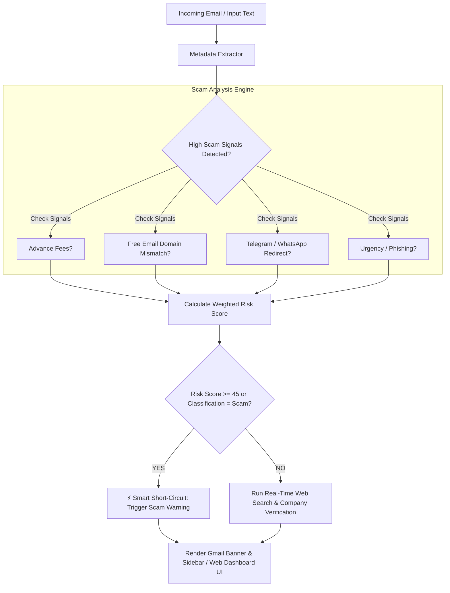

# 🛡️ Placement & Internship Scam Detector

> **Company Verifier & Automated Email Scam Analysis Engine**  
> An intelligent multi-layered security engine and Chrome Extension (Manifest V3) designed to protect job seekers, students, and candidates from placement frauds, fake internship offers, advance-fee scams, and phishing attacks.

---

## 🌟 Overview

Job and internship scams are increasingly sophisticated, targeting candidates with fake job offers, upfront fee requests (for "training," "laptop dispatch," or "security deposits"), and phishing redirects to messaging platforms like Telegram or WhatsApp.

The **Placement & Internship Scam Detector** provides a dual solution:
1. **Gmail Chrome Extension (Manifest V3):** Automatically inspects opened emails inside Gmail (`mail.google.com`), injecting real-time warning banners, badge alerts, and a detailed security sidebar.
2. **Standalone Web Dashboard:** An interactive web portal to manually paste raw email content or directly verify company legitimacy and web reputation.

---

## 🔥 Key Features

- 🎯 **Metadata Extraction Engine:** Parses incoming email headers and body text to extract company name, recruiter email, website URL, offered salary/stipend, and contact details (backed by Supabase Edge Functions with local regex fallback).
- 🧠 **Weighted Contextual Risk Classifier:** Scores emails across multiple threat vectors:
  - **Advance Fee & Payment Demands:** Triggers +35 risk score for terms like "registration fee", "security deposit", or untraceable payments (crypto, wire, gift cards).
  - **Free Email & Domain Mismatch:** Identifies recruiters using `@gmail.com` / `@yahoo.com` claiming to represent corporate entities (+25 risk score), or domain mismatches between sender address and claimed company.
  - **Messaging Redirects:** Flags attempts to move interview/hiring communication to Telegram, WhatsApp, or Signal (+25 risk score).
  - **Phishing & Urgent Pressure:** Detects high-pressure deadlines ("action required within 24 hours") and credential harvesting attempts.
- ⚡ **Smart Scam Short-Circuit Logic:** If an email scores high risk ($\ge 45$), the engine short-circuits further web queries, immediately rendering a high-visibility warning banner to protect candidate safety and conserve bandwidth.
- 🔍 **Real-Time Company Verification:** Conducts domain reachability checks, Google reviews scanning, scam complaint searches, and web reputation scoring for legitimate or borderline offers.
- 🎨 **Gmail In-Context Protection:** Injects warning banners and an interactive slide-out drawer directly into the active Gmail thread.
- 💾 **Local & Extension Caching:** Uses `chrome.storage.local` (or `localStorage` fallback) for instant retrieval of previously analyzed emails and customizable user threshold settings.

---

## 🏗️ Architecture & Pipeline Workflow



---

## 🛠️ Tech Stack

| Domain | Technologies Used |
| :--- | :--- |
| **Frontend Framework** | React 18, TypeScript, Vite |
| **Styling & UI** | Tailwind CSS, Lucide React Icons |
| **Browser Extension** | Chrome Manifest V3, `@crxjs/vite-plugin` |
| **Backend & Cloud** | Supabase, Supabase Edge Functions (Deno / TypeScript) |
| **DOM & Observer** | MutationObserver API for Gmail thread injection |
| **Code Quality** | ESLint, TypeScript (`tsc`) |

---

## 📂 Project Directory Structure

```
placement-internship_scam_detector/
├── manifest.json              # Chrome Extension Manifest V3 configuration
├── vite.config.ts             # Vite build settings & CRXJS plugin configuration
├── package.json               # Dependencies and scripts
├── .env.example               # Template for environment variables
├── public/                    # Static assets & icons
├── supabase/
│   └── functions/
│       └── extract-email/     # Supabase Edge Function for AI email extraction
└── src/
    ├── main.tsx               # Web app entry point
    ├── App.tsx                # Standalone Web Dashboard UI
    ├── index.css              # Global Tailwind CSS styles
    ├── components/            # Reusable UI components
    │   ├── WarningBanner.tsx             # Risk alert banner component
    │   ├── Sidebar.tsx                   # Slide-out analysis drawer
    │   ├── ScamShortCircuitView.tsx      # Short-circuit high-risk verdict view
    │   ├── LegitimateVerificationView.tsx # Verified company details view
    │   └── ExtractedMetadataSection.tsx  # Extracted field chips & metadata
    ├── core/                  # Security & Verification Core Logic
    │   ├── analysis/
    │   │   ├── scamRisk.ts      # Weighted scam risk classifier & rules engine
    │   │   ├── intentAnalysis.ts# Contextual intent & phishing categories
    │   │   └── emailParser.ts   # Local regex metadata parser fallback
    │   └── verification/
    │       ├── runner.ts        # Pipeline execution orchestrator
    │       └── webSearch.ts     # Company search & web reputation verification
    ├── extension/             # Chrome Extension Entrypoints
    │   ├── background.ts      # Extension Service Worker & badge updater
    │   ├── content.tsx        # Gmail Content Script & DOM injection
    │   └── popup/             # Extension toolbar popup
    ├── gmail/                 # Gmail DOM Observers & UI Containers
    │   ├── observer.ts        # Gmail DOM MutationObserver for active emails
    │   ├── banner.tsx         # Warning banner container injector
    │   └── sidebar.tsx        # Extension sidebar container injector
    ├── services/              # API and Storage utilities
    │   ├── api.ts             # Supabase edge function caller
    │   └── cache.ts           # Extension storage & local caching
    └── lib/                   # Shared TypeScript definitions & Supabase client
        ├── types.ts           # Shared interface definitions
        └── supabase.ts        # Supabase client initializer
```

---

## 🚀 Getting Started

### Prerequisites

Ensure you have the following installed:
- [Node.js](https://nodejs.org/) (v18.x or higher)
- `npm` (v9.x or higher)
- Google Chrome browser (for loading the extension)

### 1. Clone & Install Dependencies

```bash
git clone https://github.com/Jeevanandham-dev/placement-internship_scam_detector.git
cd placement-internship_scam_detector
npm install
```

### 2. Configure Environment Variables

Create a `.env` file in the root directory by copying `.env.example`:

```bash
cp .env.example .env
```

Set your Supabase project credentials in `.env`:

```env
VITE_SUPABASE_URL=https://your-supabase-project-id.supabase.co
VITE_SUPABASE_ANON_KEY=your_supabase_anon_key
```

---

## 🏃 Execution & Deployment

### Running the Web Dashboard (Development)

To launch the local web app dashboard for testing raw email analysis:

```bash
npm run dev
```

Open [http://localhost:5173](http://localhost:5173) in your browser.

### Building the Chrome Extension

To build both the web application and the Chrome Extension bundle:

```bash
npm run build
```

This compiles the production assets into the `dist/` directory.

### Loading the Extension in Google Chrome

1. Open Google Chrome and navigate to `chrome://extensions/`.
2. Enable **Developer mode** using the toggle in the top-right corner.
3. Click **Load unpacked**.
4. Select the `dist` directory generated by `npm run build`.
5. Open [Gmail](https://mail.google.com) and view any email to see the Scam Detector in action!

---

## 📜 Available NPM Scripts

- `npm run dev` – Starts Vite development server.
- `npm run build` – Compiles TypeScript and builds production output for web & Chrome extension into `dist/`.
- `npm run typecheck` – Runs TypeScript type checks (`tsc --noEmit`).
- `npm run lint` – Runs ESLint code style check across the codebase.
- `npm run preview` – Serves the built `dist` folder locally for preview.

---

## 🤝 Contributing

Contributions, issues, and feature requests are welcome!  
Feel free to open an issue or submit a pull request to help make recruitment safer for everyone.

---

## 📄 License

This project is licensed under the MIT License.

